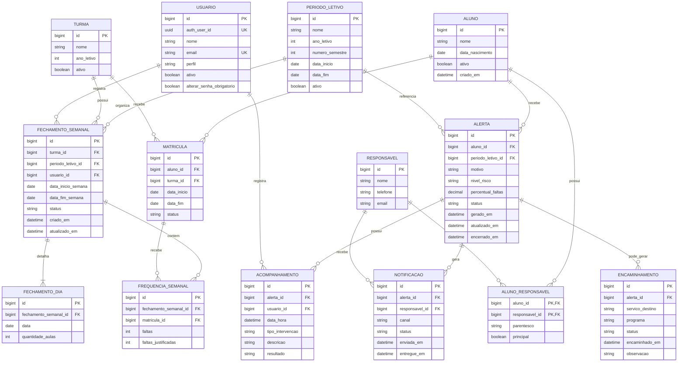

# 🎓 EduAlerta

**Sistema de monitoramento de frequência escolar e identificação de risco de evasão.**

O EduAlerta é uma aplicação web desenvolvida com o objetivo de auxiliar instituições de ensino no acompanhamento da frequência dos alunos, identificando possíveis situações de risco de evasão escolar.

A plataforma permite registrar e consolidar semanalmente as informações de frequência, acompanhar o percentual de faltas não justificadas acumuladas durante o período letivo e gerar alertas para auxiliar a instituição na identificação de alunos que necessitam de acompanhamento.

O sistema busca utilizar a tecnologia como ferramenta de apoio à gestão escolar e à prevenção da evasão, facilitando a identificação antecipada de situações que exigem atenção e o registro das intervenções realizadas pela instituição.

> 🚧 **Status:** Em desenvolvimento.

---

## 🎯 Objetivos

- Gerenciar alunos, turmas e matrículas.
- Manter o histórico de vínculos dos alunos com as turmas.
- Registrar semanalmente a quantidade de aulas realizadas em cada dia.
- Registrar as faltas e faltas justificadas dos alunos.
- Acompanhar o percentual de faltas não justificadas por período letivo.
- Identificar alunos com frequência irregular.
- Gerar alertas preventivos e críticos.
- Registrar intervenções realizadas pela instituição.
- Manter o histórico de frequência, alertas e acompanhamentos.
- Auxiliar a secretaria na identificação de possíveis situações de evasão escolar.

## ⚙️ Funcionalidades

| Funcionalidade | Descrição |
|---|---|
| Autenticação | Acesso seguro para usuários da secretaria por meio do Supabase Auth. |
| Gestão de usuários | Cadastro, consulta, atualização e desativação de usuários da secretaria. |
| Gestão de alunos | Cadastro e gerenciamento dos alunos. |
| Gestão de turmas | Organização das turmas escolares. |
| Matrículas | Controle dos vínculos entre alunos e turmas, preservando o histórico de movimentações. |
| Responsáveis | Cadastro e associação de responsáveis aos alunos. |
| Fechamento semanal | Consolidação das informações de frequência de uma turma por semana. |
| Frequência semanal | Registro de faltas e faltas justificadas por aluno. |
| Monitoramento | Cálculo do percentual acumulado de faltas não justificadas no período letivo. |
| Alertas | Identificação de situações de risco conforme os limites definidos pelo projeto. |
| Acompanhamentos | Registro das intervenções realizadas pela instituição. |
| Notificações | Registro das notificações relacionadas aos alertas. |

As funcionalidades são desenvolvidas de forma incremental. A presença de uma funcionalidade nesta documentação representa o escopo previsto, não necessariamente uma implementação já concluída.

## 🚨 Classificação de risco

O EduAlerta utiliza o percentual de faltas **não justificadas** para identificar situações que necessitam de atenção.

| Percentual de faltas não justificadas | Classificação |
|---|---|
| Abaixo de 20% | Regular |
| De 20% até abaixo de 25% | Preventivo |
| 25% ou mais | Crítico |

O cálculo utiliza a seguinte fórmula:

\[
\text{Percentual de faltas} =
\frac{\text{Faltas não justificadas}}
{\text{Aulas realizadas}}
\times 100
\]

### Regras do cálculo

- Somente fechamentos semanais com status `FECHADO` são considerados.
- Fechamentos em `RASCUNHO` não entram no cálculo.
- Faltas justificadas não são contabilizadas no percentual.
- O denominador corresponde à quantidade de aulas efetivamente realizadas.
- O cálculo considera os registros acumulados durante o período letivo.
- Os limites de classificação são parâmetros de monitoramento definidos pelo projeto.

A classificação considera como referência a frequência mínima de 75% prevista na legislação educacional aplicável, sem substituir os critérios e procedimentos oficiais da instituição de ensino.

### Exemplo

Considere um aluno que acumulou 23 faltas não justificadas em um período com 100 aulas realizadas:

\[
\frac{23}{100}\times100=23\%
\]

O resultado corresponde à classificação **Preventivo**.

## 📅 Controle de frequência

O registro da frequência é realizado por meio de fechamentos semanais por turma.

O fechamento semanal reúne as informações dos dias letivos e as frequências dos alunos vinculados às matrículas correspondentes.

### Informações registradas

**Fechamento diário:**

- Data do dia.
- Quantidade de aulas efetivamente realizadas.

**Frequência semanal por aluno:**

- Quantidade de faltas não justificadas.
- Quantidade de faltas justificadas.

Dias sem aulas, feriados e suspensões não devem contribuir para a quantidade de aulas realizadas.

### Status do fechamento

O fechamento semanal possui dois estados:

| Status | Descrição |
|---|---|
| `RASCUNHO` | Registro ainda não concluído. Não participa do cálculo de frequência. |
| `FECHADO` | Registro concluído e considerado nos cálculos do período letivo. |

A separação entre fechamento e frequência permite consolidar as informações sem precisar cadastrar individualmente cada aula ministrada.

**O sistema não utiliza uma entidade `AULA`.** A quantidade de aulas realizadas é registrada por dia em `FECHAMENTO_DIA`, enquanto as faltas são consolidadas por aluno em `FREQUENCIA_SEMANAL`.

## 🔔 Alertas e acompanhamentos

Os alertas representam situações de risco identificadas a partir do percentual de faltas não justificadas dos alunos.

Cada alerta está associado a um aluno e a um período letivo.

### Regras dos alertas

- Um aluno não pode possuir alertas duplicados para o mesmo período letivo.
- A identificação considera a combinação de aluno e período letivo.
- O alerta armazena o motivo, o nível de risco e o percentual de faltas identificado.
- Os acompanhamentos registram as intervenções realizadas pela instituição.
- O registro de uma intervenção resolve o alerta, conforme a regra de negócio definida para o projeto.

A entidade `ACOMPANHAMENTO` permite registrar informações como tipo de intervenção, descrição e resultado.

A entidade `NOTIFICACAO` mantém o registro das notificações relacionadas aos alertas. Na primeira versão, ela representa o registro da notificação, não uma integração automática com WhatsApp.

---

## 🛠️ Tecnologias

### Backend

- Java 21
- Spring Boot 4.1.2
- Spring WebMVC
- Spring Data JPA
- Hibernate
- Spring Security
- Spring OAuth2 Resource Server
- API REST
- JWT
- Spring Boot Starter Mail

### Banco de dados e autenticação

- PostgreSQL
- Supabase
- Supabase Auth
- JDBC

### Frontend

- HTML5
- CSS3
- Bootstrap
- JavaScript (Vanilla JS)
- Fetch API

### Envio de e-mails

- Gmail SMTP
- Jakarta Mail
- JavaMailSender

### Ferramentas

- Git
- GitHub
- Maven
- Neovim
- VSCodium

---

## 🏗️ Arquitetura

O EduAlerta utiliza uma arquitetura cliente-servidor. O frontend consome os endpoints REST disponibilizados pelo backend, enquanto o Spring Boot concentra as regras de negócio e a comunicação com o banco de dados.

O backend utiliza arquitetura em camadas, separando as responsabilidades da aplicação.

| Camada | Responsabilidade |
|---|---|
| Entity / Model | Representação das entidades do domínio e do banco de dados. |
| DTO | Transferência e validação dos dados recebidos e enviados pela API. |
| Repository | Persistência e acesso aos dados por meio do Spring Data JPA. |
| Service | Implementação das regras de negócio. |
| Controller | Exposição dos endpoints REST. |
| Security | Validação de tokens e controle de acesso. |
| Config | Configurações gerais da aplicação. |

### Comunicação entre os componentes

1. O usuário realiza a autenticação pelo Supabase Auth.
2. O Supabase retorna um JWT de acesso.
3. O frontend utiliza o token nas requisições protegidas.
4. O Spring Security valida o JWT recebido.
5. O backend identifica o usuário autenticado e verifica seu cadastro no banco do EduAlerta.
6. As regras de negócio são executadas pelos serviços.
7. O Spring Data JPA realiza as operações no PostgreSQL.
8. A API retorna os resultados ao frontend em JSON.

O frontend não acessa diretamente o PostgreSQL. Toda operação sobre os dados da aplicação passa pelo backend.

---

## 🗄️ Banco de dados

O banco de dados utiliza PostgreSQL, hospedado pelo Supabase.

A aplicação utiliza o schema `app` para organizar as tabelas do sistema.

### Entidades

| Entidade | Responsabilidade |
|---|---|
| `PERIODO_LETIVO` | Representa o período escolar, como um semestre. |
| `TURMA` | Representa as turmas da instituição. |
| `ALUNO` | Armazena os dados dos alunos. |
| `MATRICULA` | Representa o vínculo do aluno com uma turma, preservando o histórico. |
| `USUARIO` | Armazena os usuários internos autorizados a acessar o sistema. |
| `FECHAMENTO_SEMANAL` | Representa o fechamento de frequência de uma turma em determinada semana. |
| `FECHAMENTO_DIA` | Armazena a quantidade de aulas realizadas em cada dia do fechamento. |
| `FREQUENCIA_SEMANAL` | Registra as faltas e faltas justificadas dos alunos em determinado fechamento. |
| `RESPONSAVEL` | Armazena os dados dos responsáveis pelos alunos. |
| `ALUNO_RESPONSAVEL` | Relaciona alunos e responsáveis. |
| `ALERTA` | Armazena situações de risco identificadas para os alunos. |
| `ACOMPANHAMENTO` | Registra as intervenções realizadas pela instituição. |
| `NOTIFICACAO` | Mantém os registros de notificações relacionadas aos alertas. |
| `ENCAMINHAMENTO` | Representa possíveis encaminhamentos relacionados aos alertas, previsto como funcionalidade opcional. |

### Modelo entidade-relacionamento



### Decisões importantes da modelagem

**Matrícula e histórico escolar**

A turma não é armazenada diretamente no cadastro do aluno. O relacionamento é feito por meio de `MATRICULA`, permitindo registrar mudanças de turma sem perder os vínculos anteriores.

**Fechamento semanal**

A frequência não exige o cadastro individual de cada aula. O fechamento semanal agrupa os registros diários de aulas realizadas e os registros de frequência dos alunos.

**Frequência vinculada à matrícula**

A entidade `FREQUENCIA_SEMANAL` referencia a matrícula, e não diretamente o aluno. Isso permite preservar a relação entre o registro de frequência e o vínculo escolar correspondente.

**Alertas por período letivo**

A identificação de risco considera o aluno e o período letivo, evitando a duplicação de alertas para a mesma combinação.

**Separação entre alerta e acompanhamento**

O alerta representa a situação identificada pelo sistema. O acompanhamento representa a intervenção realizada pela instituição.

---

## 🔐 Autenticação e segurança

A autenticação dos usuários é realizada pelo **Supabase Auth**.

O backend Spring Boot atua como servidor de recursos, validando os tokens JWT e controlando o acesso aos endpoints da aplicação por meio do Spring Security.

### Perfis de acesso

A primeira versão possui exclusivamente o perfil:

- **SECRETARIA:** gerenciamento dos dados escolares, registro e fechamento das frequências, consulta dos alertas e registro dos acompanhamentos.

O perfil **PROFESSOR foi retirado do escopo inicial**. Portanto, não haverá login, cadastro ou acesso de professores à plataforma nesta versão.

O registro de frequência e o fechamento semanal ficam sob responsabilidade dos usuários autorizados da secretaria.

Alunos e responsáveis também não possuem acesso autenticado ao sistema na primeira versão.

### Gerenciamento de usuários

Não existe cadastro público de usuários.

A primeira secretaria é provisionada manualmente no Supabase Auth e vinculada ao registro correspondente na tabela `USUARIO`.

Depois do provisionamento inicial, uma secretaria ativa e autenticada pode cadastrar outras secretarias.

O cadastro utiliza uma senha temporária gerada pelo backend e enviada por e-mail. O usuário deve alterá-la no primeiro acesso antes de utilizar as demais funcionalidades protegidas.

O Supabase Auth é responsável pelas credenciais e pela identidade do usuário. A tabela `USUARIO` mantém os dados necessários para a operação interna do EduAlerta.

---

## 📧 Envio de e-mails

O envio de e-mails é realizado pelo backend utilizando o Gmail SMTP, por meio do `JavaMailSender`.

Na primeira versão, o envio é utilizado principalmente para encaminhar as credenciais temporárias geradas durante o cadastro de novos usuários.

A configuração utiliza:

- Servidor SMTP do Gmail.
- Porta 587.
- Autenticação SMTP.
- STARTTLS.
- Senha de aplicativo do Google.

Não é necessário possuir domínio próprio para utilizar uma conta Gmail como remetente, respeitando os limites e as políticas do provedor.

---

## ⚙️ Configuração do projeto

O projeto utiliza arquivos `application.properties` para armazenar as configurações da aplicação.

As credenciais e informações específicas de cada instalação devem ser preenchidas manualmente pelo responsável pela execução do projeto.

**O funcionamento do backend não depende de variáveis de ambiente.**

O repositório disponibiliza um arquivo de exemplo:

```text
application.properties.example
```

Para executar a aplicação, copie esse modelo para:

```text
src/main/resources/application.properties
```

Em seguida, preencha os dados de conexão com o PostgreSQL/Supabase, as configurações do Supabase Auth e as credenciais SMTP.

O arquivo `application.properties` com credenciais reais não deve ser versionado no Git.

---

## 📂 Estrutura do projeto

A estrutura geral do repositório está organizada para separar o backend e o frontend.

```text
EduAlerta/
│
├── back-end/
│   └── edualerta/
│       ├── src/
│       │   ├── main/
│       │   │   ├── java/
│       │   │   │   └── edu/uninassau/edualerta/
│       │   │   │       ├── config/
│       │   │   │       │   └── security/
│       │   │   │       ├── controllers/
│       │   │   │       ├── dtos/
│       │   │   │       ├── models/
│       │   │   │       ├── repositorys/
│       │   │   │       └── services/
│       │   │   │           ├── interfaces/
│       │   │   │           └── impls/
│       │   │   └── resources/
│       │   │       └── application.properties
│       │   └── test/
│       ├── application.properties.example
│       ├── mvnw
│       ├── mvnw.cmd
│       └── pom.xml
│
├── front-end/
│   └── ...
│
└── README.md
```

A estrutura apresentada representa a organização prevista para o projeto e pode receber novos diretórios conforme os módulos forem implementados.

---

## 🚀 Executando o projeto

O projeto está em desenvolvimento. As instruções abaixo representam a preparação para executar o backend.

### Pré-requisitos

- Java 21.
- Maven (opcional, pois o projeto possui Maven Wrapper).
- Conta e projeto no Supabase.
- PostgreSQL disponibilizado pelo Supabase.
- Conta Gmail com autenticação em duas etapas e senha de aplicativo configurada para o envio de e-mails.

### 1. Clone o repositório

```bash
git clone URL_DO_REPOSITORIO
```

### 2. Entre no diretório do backend

```bash
cd EduAlerta/back-end/edualerta
```

### 3. Configure as propriedades

Copie o arquivo de exemplo:

```bash
cp application.properties.example src/main/resources/application.properties
```

Preencha as propriedades com os dados da sua instalação.

### 4. Execute a aplicação

No Linux:

```bash
./mvnw spring-boot:run
```

No Windows:

```powershell
.\mvnw.cmd spring-boot:run
```

O backend utiliza a porta `9000` por padrão.

A aplicação depende de uma configuração válida do PostgreSQL e do Supabase para iniciar corretamente.

---

## 📌 Escopo da primeira versão

O desenvolvimento é realizado de forma incremental, priorizando os recursos essenciais para o funcionamento do sistema.

1. Modelagem e estruturação do banco de dados.
2. Configuração do backend Spring Boot.
3. Integração com Supabase Auth.
4. Autenticação e controle de acesso da secretaria.
5. Gerenciamento de usuários.
6. Gerenciamento de alunos, turmas e matrículas.
7. Cadastro e associação de responsáveis.
8. Fechamento semanal de frequência.
9. Cálculo semestral do percentual de faltas.
10. Geração e gerenciamento de alertas.
11. Registro de acompanhamentos.
12. Desenvolvimento e integração do frontend.

### Funcionalidades fora do escopo inicial

- Login e acesso de professores.
- Login de alunos.
- Login de responsáveis.
- Integração com WhatsApp.
- Envio automático de mensagens por WhatsApp.
- Aplicativo mobile nativo.

A entidade `ENCAMINHAMENTO` permanece prevista na modelagem como funcionalidade opcional, sujeita à disponibilidade de tempo e à priorização da entrega.

---

## 📖 Sobre o projeto

O EduAlerta é um projeto acadêmico desenvolvido no contexto do curso de Análise e Desenvolvimento de Sistemas, com foco na aplicação prática de conceitos de engenharia de software, desenvolvimento web, modelagem de dados, APIs REST, autenticação e persistência de dados.

O projeto busca demonstrar como sistemas de informação podem apoiar a gestão escolar, facilitar o acompanhamento da frequência e contribuir para a identificação antecipada de possíveis situações de evasão.

**Desenvolvimento:** Em andamento.
