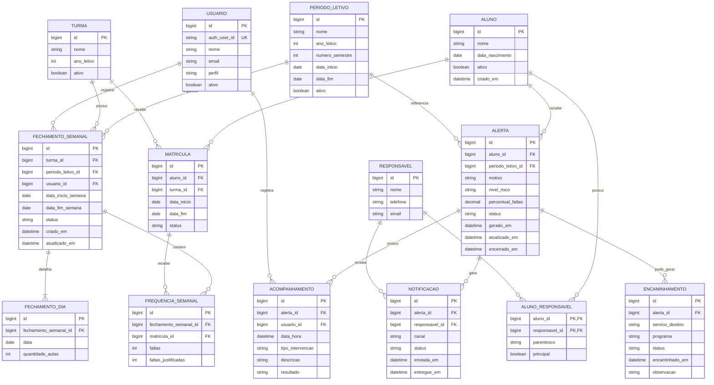

# 🎓 EduAlerta

**Sistema de monitoramento de frequência escolar e identificação de risco de evasão.**

O EduAlerta é uma aplicação web desenvolvida com o objetivo de auxiliar instituições de ensino no acompanhamento da frequência dos alunos, identificando possíveis situações de risco de evasão escolar.

A plataforma permite registrar a frequência semanal, acompanhar o percentual de faltas acumuladas durante o semestre e gerar alertas para auxiliar a instituição na identificação de alunos que necessitam de acompanhamento.

O projeto busca utilizar a tecnologia como ferramenta de apoio à gestão escolar e à prevenção da evasão, facilitando a identificação antecipada de situações que exigem atenção.

> 🚧 **Status:** Em desenvolvimento.

---

## 🎯 Objetivos

- Gerenciar alunos, turmas e matrículas.
- Registrar semanalmente as aulas realizadas e as faltas dos alunos.
- Acompanhar o percentual de faltas por semestre.
- Identificar alunos com frequência irregular.
- Gerar alertas preventivos e críticos.
- Registrar intervenções realizadas pela instituição.
- Manter o histórico de frequência e acompanhamento dos alunos.

## ⚙️ Funcionalidades

| Funcionalidade | Descrição |
|---|---|
| Autenticação | Acesso seguro para funcionários da instituição. |
| Gestão de alunos | Cadastro e gerenciamento dos alunos. |
| Gestão de turmas | Organização das turmas escolares. |
| Matrículas | Controle de vínculos entre alunos e turmas, preservando o histórico. |
| Frequência semanal | Registro das aulas realizadas por dia e das faltas por aluno. |
| Monitoramento | Cálculo do percentual de faltas acumuladas no semestre. |
| Alertas | Identificação automática de situações de risco. |
| Intervenções | Registro das ações realizadas pela instituição. |

## 🚨 Classificação de risco

O EduAlerta utiliza o percentual de faltas não justificadas para identificar situações que necessitam de atenção.

| Percentual de faltas | Classificação |
|---|---|
| Abaixo de 20% | Regular |
| De 20% até abaixo de 25% | Preventivo |
| 25% ou mais | Crítico |

Os limites são utilizados como parâmetros de monitoramento do projeto, considerando a referência de frequência mínima de 75% prevista na legislação educacional aplicável.

## 📅 Controle de frequência

O registro da frequência é realizado por meio de fechamentos semanais por turma.

O professor informa:

- Quantidade de aulas realizadas em cada dia da semana.
- Quantidade de faltas não justificadas de cada aluno.
- Quantidade de faltas justificadas de cada aluno.

Dias sem aulas, feriados e suspensões não entram no cálculo da frequência.

O sistema considera apenas fechamentos concluídos para calcular o percentual de faltas acumuladas no semestre.

## 🛠️ Tecnologias

### Backend
- Java
- Spring Boot
- Spring Data JPA
- Hibernate
- Spring Security
- API REST
- JWT

### Banco de dados
- PostgreSQL
- Supabase

### Frontend
- HTML5
- CSS3
- Bootstrap
- JavaScript (Vanilla JS)
- Fetch API

### Ferramentas
- Git
- GitHub
- Neovim
- VSCodium

## 🏗️ Arquitetura

O backend utiliza arquitetura em camadas, separando as responsabilidades da aplicação.

| Camada | Responsabilidade |
|---|---|
| Entity | Representação das entidades do banco de dados. |
| DTO | Transferência e validação dos dados. |
| Repository | Persistência e acesso aos dados. |
| Service | Implementação das regras de negócio. |
| Controller | Exposição dos endpoints REST. |
| Security | Autenticação e autorização. |
| Config | Configurações gerais da aplicação. |

O frontend consome a API REST disponibilizada pelo backend. O acesso ao banco de dados é realizado exclusivamente pelo Spring Boot.

### Banco de dados

A modelagem considera as seguintes entidades principais:

- `ALUNO`
- `RESPONSAVEL`
- `ALUNO_RESPONSAVEL`
- `TURMA`
- `MATRICULA`
- `USUARIO`
- `PERIODO_LETIVO`
- `FECHAMENTO_SEMANAL`
- `FECHAMENTO_DIA`
- `FREQUENCIA_SEMANAL`
- `ALERTA`
- `ACOMPANHAMENTO`
- `NOTIFICACAO`
- `ENCAMINHAMENTO`





    

A frequência é registrada semanalmente, sem a necessidade de cadastrar cada aula individualmente.

## 🔐 Autenticação e segurança

A autenticação dos funcionários será realizada pelo Supabase Auth.

O backend Spring Boot será responsável por validar os tokens JWT e controlar as permissões de acesso.

O sistema terá inicialmente dois perfis:

- **SECRETARIA:** gerenciamento e acompanhamento da instituição.
- **PROFESSOR:** registro e consulta da frequência das turmas autorizadas.

As credenciais e informações sensíveis serão armazenadas por meio de variáveis de ambiente.

## 📂 Estrutura do projeto

A estrutura dos diretórios será documentada conforme o desenvolvimento da aplicação.

```text
EduAlerta/
├── backend/
│   └── ...
├── frontend/
│   └── ...
└── README.md
```

## 🚀 Executando o projeto

O projeto ainda está em desenvolvimento. As instruções de instalação e execução serão adicionadas conforme a implementação do backend e frontend.

### Pré-requisitos previstos

- Java 21 ou superior.
- Maven.
- PostgreSQL.
- Node.js (opcional para ferramentas auxiliares do frontend).
- Conta e projeto no Supabase.

## 📌 Escopo inicial

O desenvolvimento será realizado de forma incremental, priorizando:

1. Estruturação do banco de dados.
2. Configuração do backend Spring Boot.
3. Autenticação e controle de acesso.
4. Gerenciamento de alunos, turmas e matrículas.
5. Fechamento semanal de frequência.
6. Cálculo semestral e geração de alertas.
7. Registro de intervenções.
8. Desenvolvimento e integração do frontend.

Funcionalidades como notificações automáticas e integração com WhatsApp não fazem parte da primeira versão.

---

## 📖 Sobre o projeto

O EduAlerta é um projeto acadêmico desenvolvido no contexto da área de Análise e Desenvolvimento de Sistemas, com foco na aplicação de conceitos de desenvolvimento web, engenharia de software, banco de dados e prevenção da evasão escolar.

**Desenvolvimento:** Em andamento.
