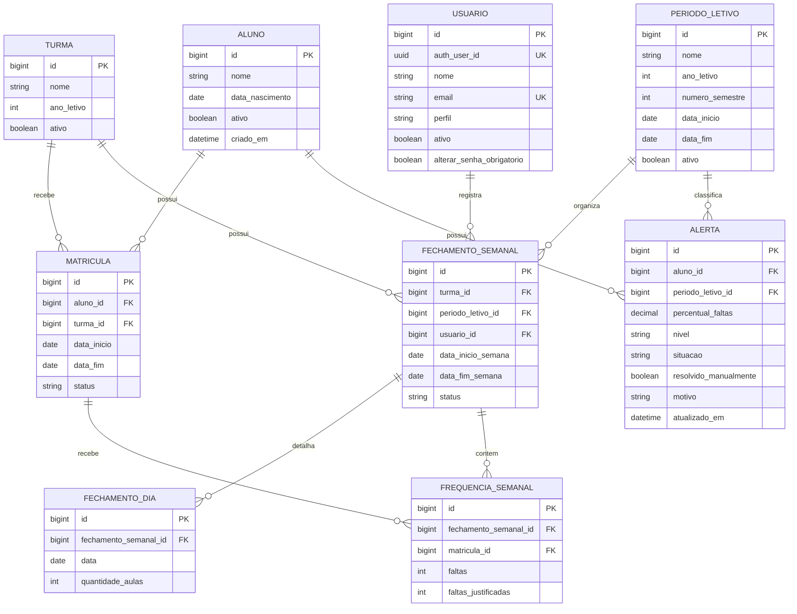
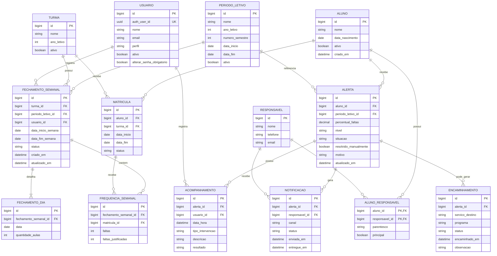

# 🎓 EduAlerta

**Sistema de monitoramento de frequência escolar e identificação de risco de evasão.**

O EduAlerta é uma aplicação web desenvolvida com o objetivo de auxiliar instituições de ensino no acompanhamento da frequência dos alunos, identificando possíveis situações de risco de evasão escolar.

A plataforma permite organizar os dados escolares, gerenciar alunos, turmas, matrículas e períodos letivos. O backend também permite criar e fechar semanas por turma, registrar aulas realizadas por dia, lançar faltas não justificadas e justificadas por matrícula, consultar a frequência acumulada de uma matrícula e gerar ou atualizar automaticamente alertas por aluno e período letivo quando um fechamento semanal é concluído.

A consulta e a resolução manual de alertas já estão disponíveis na API. O registro de acompanhamentos, notificações e relatórios permanece em desenvolvimento.

O sistema busca utilizar a tecnologia como ferramenta de apoio à gestão escolar e à prevenção da evasão, facilitando a identificação antecipada de situações que exigem atenção e o registro das intervenções realizadas pela instituição.

> 🚧 **Status: Em desenvolvimento.** O backend possui autenticação, gerenciamento escolar, fechamento semanal, frequência por matrícula, consulta de frequência acumulada, cálculo percentual, geração/atualização automática e resolução manual de alertas. O frontend possui integração com autenticação, gestão escolar, usuários, fechamento/frequência semanal, consulta de frequência acumulada, painel de indicadores e consulta/gestão de alertas. Acompanhamentos, notificações, encaminhamentos e relatórios ainda não possuem implementação funcional.

---

## 👥 Integrantes do projeto

- José Ricardo
- Francileidy Conceição
- Adrielly Kauany
- Itamar Kauan
- Pedro Cauã Vicente
- Miguel Azevedo

---

## 📌 Estado atual do desenvolvimento

O desenvolvimento do EduAlerta acontece de forma incremental. Esta seção apresenta o estado dos módulos considerando o backend e o frontend disponíveis no projeto.

### Implementado no backend

- Integração com Supabase Auth para autenticação por JWT.
- Validação dos tokens pelo Spring Security como OAuth2 Resource Server.
- Associação do usuário autenticado ao registro local da tabela `tb_usuario`.
- Bloqueio de contas inativas.
- Bloqueio de usuários que ainda precisam trocar a senha temporária.
- Cadastro administrativo de usuários com perfil `SECRETARIA`.
- Geração de senhas temporárias e envio por e-mail.
- Consulta, edição de nome, desativação e reativação de usuários conforme as regras de perfil.
- CRUD de alunos, incluindo alteração de status.
- CRUD de turmas, incluindo alteração de status e validação do ano letivo.
- CRUD de períodos letivos, incluindo alteração de status e validação das datas.
- Gerenciamento de matrículas, incluindo cadastro, consulta, encerramento e transferência entre turmas.
- Tratamento centralizado de erros de validação, regras de negócio, acesso negado e recursos não encontrados.
- Cadastro, consulta e fechamento de semanas por turma e período letivo.
- Registro, edição e remoção da quantidade de aulas realizadas em cada dia da semana, inclusive zero aulas.
- Registro, consulta, edição e remoção de frequência semanal por matrícula, separando faltas não justificadas e justificadas.
- Validações de vínculo da matrícula com a turma e com o intervalo semanal, limites de faltas em relação às aulas realizadas e bloqueio de alterações após o fechamento.
- Consulta da frequência acumulada de uma matrícula, considerando somente faltas não justificadas e registros de fechamentos `FECHADO` dentro do intervalo da matrícula.
- Cálculo do percentual de faltas não justificadas por aluno e período letivo.
- Geração e atualização automática de alertas ao fechar uma semana.
- Consulta de alertas com filtros opcionais por aluno, período letivo, nível e situação.
- Resolução manual de alertas por meio de endpoint próprio, disponível para os perfis `ADM` e `SECRETARIA`.

### Implementado ou integrado no frontend

- Tela de login integrada ao Supabase Auth.
- Validação posterior do usuário autenticado pela API.
- Proteção das páginas internas por sessão, perfil permitido e situação da conta.
- Redirecionamento para troca obrigatória de senha no primeiro acesso.
- Consulta do usuário autenticado por `GET /usuarios/me`.
- Gestão de usuários integrada à API.
- Cadastro de secretarias por ADM.
- Alteração de nome e ativação/desativação de contas.
- Gestão de alunos integrada à API: cadastro, listagem, pesquisa, edição e alteração de status.
- Gestão de turmas integrada à API: cadastro, listagem, pesquisa, edição e alteração de status.
- Gestão de matrículas integrada à API: cadastro, listagem, pesquisa, encerramento e transferência.
- Gestão de períodos letivos integrada à API: cadastro, listagem, edição e alteração de status.
- Gestão de fechamentos semanais e frequências integrada à API: criação e consulta de fechamentos, registro/edição/remoção de dias, lançamento/edição/remoção de frequências e fechamento definitivo da semana.
- Layout compartilhado com identificação do usuário, perfil, navegação entre páginas e encerramento da sessão.
- Painel integrado à API, com indicadores de alunos ativos, matrículas ativas, fechamentos concluídos e alertas ativos, além da exibição dos cinco alertas ativos mais recentes.
- Tela de alertas integrada à API, com filtros por aluno, período letivo, nível e situação, exibição de percentual/motivo e resolução manual.
- Tela de consulta de frequência integrada à API, com histórico de matrículas por aluno e consulta do acumulado de faltas não justificadas, aulas realizadas e percentual por matrícula.

### Ainda não implementado no backend

- Cadastro e associação de responsáveis.
- Registro de acompanhamentos e intervenções.
- Notificações e encaminhamentos.
- Endpoints de dashboard e relatórios.
- Associação da resolução manual de alertas a um registro de acompanhamento/intervenção. A resolução manual já existe, mas ainda não há entidade ou fluxo de acompanhamento vinculado a ela.
- Cobertura abrangente de testes automatizados. No código atual, há apenas um teste de contexto (`contextLoads`); as regras de negócio e os endpoints ainda precisam de testes automatizados específicos.

As seções seguintes distinguem as funcionalidades já disponíveis na API daquelas que permanecem apenas previstas na modelagem ou no escopo futuro.

---

## ⚙️ Funcionalidades e situação

| Funcionalidade | Situação no backend | Descrição |
|---|---|---|
| Autenticação | Implementada | Supabase Auth e validação de JWT pelo Spring Security. |
| Gestão de usuários | Implementada | Cadastro de secretarias, consulta, alteração de nome e alteração de status. |
| Gestão de alunos | Implementada | Cadastro, listagem, consulta por ID, edição e ativação/desativação. |
| Gestão de turmas | Implementada | Cadastro, listagem, consulta por ID, edição e ativação/desativação. |
| Períodos letivos | Implementada | Cadastro, listagem, consulta por ID, edição e ativação/desativação. |
| Matrículas | Implementada | Cadastro, listagem, consulta, histórico por aluno, encerramento e transferência. |
| Responsáveis | Pendente | Cadastro e associação de responsáveis aos alunos. |
| Fechamento semanal | Implementada | Criação, listagem, consulta, manutenção dos dias letivos e fechamento definitivo de uma semana por turma e período letivo. |
| Frequência semanal | Implementada | Registro, listagem, edição e remoção de faltas não justificadas e justificadas por matrícula, enquanto o fechamento estiver em rascunho. |
| Frequência acumulada | Implementada | Consulta do total de faltas não justificadas, aulas realizadas e percentual da matrícula. |
| Classificação de risco | Implementada | Classificação automática por aluno e período letivo. |
| Alertas | Implementada | Geração/atualização automática ao fechar semanas, consulta com filtros por aluno, período, nível e situação, além de resolução manual. |
| Acompanhamentos | Pendente | Registro das intervenções realizadas pela instituição. |
| Notificações | Pendente | Registro de notificações relacionadas aos alertas. |
| Encaminhamentos | Opcional | Registro de possíveis encaminhamentos relacionados aos alertas. |

### Situação das telas no frontend

| Tela | Situação | Observação |
|---|---|---|
| Login (`index.html`) | Integrada | Autentica pelo Supabase Auth e consulta `/usuarios/me` para validar o acesso. |
| Alterar senha (`alterar-senha.html`) | Integrada | Envia a nova senha para `PUT /usuarios/me/senha`. |
| Usuários (`usuarios.html`) | Integrada | Lista usuários; ADM pode cadastrar secretarias, alterar nome e ativar/desativar contas. |
| Minha conta (`minha-conta.html`) | Integrada | Consulta os dados da conta, permite atualizar o próprio nome e desativar a própria conta. |
| Alunos (`alunos.html`) | Integrada | CRUD e alteração de status por meio de `/alunos`. |
| Turmas (`turmas.html`) | Integrada | CRUD e alteração de status por meio de `/turmas`. |
| Matrículas e períodos (`matriculas.html`) | Integrada | Cadastro, consulta, encerramento e transferência de matrículas; CRUD e status de períodos letivos. |
| Painel (`painel.html`) | Integrada | Consulta alunos, matrículas, fechamentos e alertas; calcula indicadores no frontend e exibe os cinco alertas ativos mais recentes. |
| Frequência (`frequencias.html`) | Integrada | Gerencia fechamentos semanais, dias/aulas e frequências por matrícula usando os endpoints da API. |
| Consulta de frequência (`consulta-frequencia.html`) | Integrada | Consulta o histórico de matrículas de um aluno e solicita a frequência acumulada de cada matrícula. |
| Alertas (`alertas.html`) | Integrada | Consulta alertas pela API, oferece filtros por aluno, período, nível e situação e permite resolver alertas ativos. |
| Acompanhamentos (`acompanhamento.html`) | Apenas estrutura visual | Não registra intervenções nem notificações. |
| Relatórios (`relatorios.html`) | Apenas estrutura visual | Não consulta nem consolida dados da API. |

---

## 🖥️ Frontend — funcionamento atual

O frontend é uma aplicação web estática construída com HTML, CSS, Bootstrap e JavaScript puro.

As páginas compartilham o cabeçalho e a navegação, montados pelo JavaScript após a validação da sessão.

### Autenticação e proteção das páginas

1. O formulário de `index.html` autentica e-mail e senha pelo Supabase Auth, utilizando `signInWithPassword`.
2. Após o login, o frontend consulta `GET /usuarios/me`, enviando o JWT no cabeçalho `Authorization: Bearer`.
3. O acesso é aceito somente para os perfis `ADM` e `SECRETARIA`, com conta ativa.
4. Se `alterarSenhaObrigatorio` estiver verdadeiro, o usuário é encaminhado para `alterar-senha.html`.
5. As páginas internas permanecem ocultas até a validação do usuário terminar.
6. A opção de sair encerra a sessão no Supabase e redireciona para `index.html`.

A proteção no frontend melhora o fluxo de navegação, mas não substitui a autorização do backend. As regras de acesso efetivas também são aplicadas pela API.

### Comunicação com a API

A comunicação é centralizada em `js/auth.js`.

As principais responsabilidades são:

- `obterToken()`: recupera o access token da sessão do Supabase.
- `requisicaoAPI(caminho, opcoes)`: executa `fetch` para a URL base configurada e acrescenta o cabeçalho `Authorization`.
- Respostas HTTP `204` são tratadas sem corpo.
- Em respostas de erro, o frontend tenta apresentar `detail`, `message` ou `mensagem` retornados pela API.

O arquivo `js/config.js` concentra:

- URL do Supabase.
- Chave pública de acesso.
- URL base da API.
- Caminho de consulta do usuário atual.

A configuração local utiliza a API em `http://localhost:9000`.

### Regras e comportamentos presentes nas telas integradas

**Alunos**

- Formulário com nome e data de nascimento.
- Listagem com pesquisa.
- Edição dos dados.
- Ativação e desativação.

**Turmas**

- Formulário com nome e ano letivo.
- Listagem com pesquisa.
- Edição dos dados.
- Ativação e desativação.

**Matrículas**

- Seleção de aluno e turma ativos.
- Data de início.
- Consulta do histórico de matrículas.
- Pesquisa.
- Encerramento de matrículas.
- Transferência entre turmas.

Encerramento e transferência solicitam datas no formato `DD/MM/AAAA` e convertem para `AAAA-MM-DD` antes de enviar à API.

**Períodos letivos**

- Cadastro e edição de nome, ano, semestre, data inicial e data final.
- A tela impede que a data final seja anterior à data inicial.
- Listagem e alteração de status.

**Consulta de frequência**

- Carrega os alunos cadastrados.
- Consulta o histórico de matrículas do aluno selecionado.
- Exibe turma, datas de vínculo e status de cada matrícula.
- Permite consultar, por matrícula, faltas não justificadas, aulas realizadas e percentual acumulado pelo endpoint `/matriculas/{id}/frequencia-acumulada`.

**Frequência**

- Consulta fechamentos com filtros por turma e período letivo.
- Criação de fechamento semanal, com início em uma segunda-feira.
- Consulta dos dias e das frequências registrados.
- Inclusão, edição e remoção de dias e quantidades de aulas enquanto o fechamento está em rascunho.
- Lançamento, edição e remoção de faltas não justificadas e justificadas por matrícula.
- Fechamento definitivo da semana após as validações do backend.

**Painel**

- Consulta alunos, matrículas, fechamentos semanais e alertas em paralelo.
- Calcula no frontend a quantidade de alunos ativos, matrículas ativas, fechamentos fechados e alertas ativos.
- Exibe a quantidade de alertas críticos entre os ativos e até cinco alertas ativos recentes.

**Alertas**

- Carrega alunos e períodos letivos para preencher os filtros.
- Consulta alertas com filtros opcionais por aluno, período letivo, nível e situação.
- Exibe percentual de faltas, nível, situação, motivo e data de atualização.
- Permite resolver manualmente alertas ativos, respeitando as permissões da API.

**Usuários**

- Listagem de nome, e-mail, perfil, status e situação da troca de senha.

**Minha conta**

- Consulta e exibe e-mail, perfil e status da conta autenticada.
- Permite atualizar o próprio nome pelo endpoint `PUT /usuarios/me`.
- Permite solicitar a desativação da própria conta pelo endpoint `DELETE /usuarios/me`.
- Cadastro de secretarias.
- Alteração de nome.
- Ativação e desativação de contas.
- Ações administrativas exibidas somente quando o usuário logado possui perfil `ADM`.

---

## 🔐 Perfis e permissões de acesso

O código atual possui dois perfis definidos no enum `Perfil`:

- `ADM`
- `SECRETARIA`

Não existe perfil `PROFESSOR` na implementação atual.

Cada perfil possui permissões específicas, definidas no backend.

| Operação | ADM | SECRETARIA |
|---|:---:|:---:|
| Acessar o sistema | Sim | Sim |
| Consultar a lista de usuários | Sim | Sim |
| Buscar usuários | Sim | Sim |
| Cadastrar novas secretarias | Sim | Não |
| Alterar o nome de outras secretarias | Sim | Não |
| Ativar contas de secretaria | Sim | Não |
| Desativar contas de secretaria | Sim | Não |
| Gerenciar alunos, turmas e matrículas | Sim | Sim |
| Gerenciar períodos letivos | Sim | Sim |
| Registrar e fechar frequências | Sim | Sim |
| Consultar alertas | Sim | Sim |
| Resolver alertas manualmente | Sim | Sim |
| Registrar acompanhamentos | Futuro | Futuro |

### ADM

O perfil `ADM` é responsável pelo gerenciamento das contas de secretaria.

Suas permissões incluem:

- Cadastrar novos usuários com perfil `SECRETARIA`.
- Consultar e buscar usuários cadastrados.
- Alterar o nome de outras contas `SECRETARIA`.
- Ativar e desativar contas `SECRETARIA`.
- Acessar as funcionalidades gerais do sistema.

As operações administrativas de alteração de nome e status não permitem que o ADM altere a própria conta por esses endpoints.

### SECRETARIA

O perfil `SECRETARIA` possui acesso às funcionalidades operacionais do EduAlerta.

Suas permissões atuais incluem:

- Consultar e buscar usuários cadastrados.
- Gerenciar alunos, turmas e matrículas.
- Gerenciar períodos letivos.
- Registrar e fechar frequências semanais.
- Consultar alertas.
- Resolver alertas manualmente.

Para os módulos futuros, também está prevista a possibilidade de:

- Cadastrar e associar responsáveis.
- Registrar acompanhamentos e intervenções.

A secretaria não pode cadastrar novos usuários, alterar o nome de outras secretarias ou modificar o status de suas contas.

### Provisionamento inicial

Não existe cadastro público de usuários.

A primeira conta administrativa é provisionada manualmente no Supabase Auth e vinculada ao registro correspondente na tabela `tb_usuario`, com perfil `ADM`.

O registro local deve possuir o mesmo UUID de identidade do usuário no Supabase Auth, armazenado em `auth_user_id`.

Após esse provisionamento, o ADM pode cadastrar novas contas com perfil `SECRETARIA`.

### Cadastro de secretaria e primeiro acesso

Ao cadastrar uma secretaria:

1. O backend gera uma senha temporária.
2. Cria a identidade do usuário no Supabase Auth.
3. Persiste os dados locais em `tb_usuario`, com perfil `SECRETARIA`.
4. Marca `alterar_senha_obrigatorio` como `true`.
5. Envia a senha temporária por e-mail.
6. Se ocorrer falha durante a persistência local ou o envio do e-mail, o backend tenta excluir a identidade criada no Supabase.

No primeiro acesso, o usuário deve alterar a senha pelo endpoint `PUT /usuarios/me/senha`.

Enquanto `alterarSenhaObrigatorio` estiver ativo, as operações protegidas que utilizam o contexto normal do usuário são bloqueadas. A consulta de `/usuarios/me` e a troca de senha permanecem disponíveis para permitir a conclusão do primeiro acesso.

### Contas desativadas

Uma conta de secretaria desativada não pode realizar login no sistema.

O bloqueio é aplicado no Supabase Auth e também é verificado pelo backend.

Quando o ADM altera o status de uma secretaria, o serviço atualiza o bloqueio correspondente no Supabase Auth e o status do registro local.

Assim, mesmo que o usuário possua um JWT emitido anteriormente, o backend deve rejeitar as requisições quando a conta estiver inativa.

A reativação da conta também é realizada pelo ADM.

A desativação da própria conta pelo endpoint `DELETE /usuarios/me` também desativa a identidade no Supabase Auth e marca o registro local como inativo.

Alunos e responsáveis não possuem acesso autenticado ao sistema na primeira versão.

### Regras gerais de segurança

- Todos os endpoints da API exigem autenticação.
- O token deve ser enviado no cabeçalho `Authorization: Bearer <JWT>`.
- O Spring Security valida o JWT recebido.
- O `UsuarioContext` converte o `sub` do JWT em UUID.
- O UUID é utilizado para localizar o usuário local por `auth_user_id`.
- Contas inativas são bloqueadas.
- A troca obrigatória de senha restringe o acesso às operações comuns até a atualização da credencial.
- As regras de acesso são verificadas pelo backend, independentemente da proteção visual do frontend.
- O CORS atual permite origens `localhost` e `127.0.0.1` com portas variáveis, métodos `GET`, `POST`, `PUT`, `DELETE` e `OPTIONS`, e cabeçalhos `Authorization` e `Content-Type`.

---

## 🌐 API REST — Endpoints implementados

**Base URL local:** `http://localhost:9000`

Todos os endpoints abaixo exigem JWT válido.

Para as rotas protegidas, envie:

```http
Authorization: Bearer SEU_TOKEN_JWT
Content-Type: application/json
```

A autenticação é realizada diretamente pelo Supabase Auth. O login não corresponde a um endpoint do backend Spring Boot.

Os endpoints e métodos desta seção representam os controllers presentes no backend documentado.

### Usuários — `/usuarios`

| Método | Endpoint | Descrição | Regra de acesso |
|---|---|---|---|
| `POST` | `/usuarios` | Cadastra uma nova secretaria. | Somente `ADM`. |
| `GET` | `/usuarios/me` | Consulta os dados do usuário autenticado. | Usuário autenticado, inclusive durante a troca obrigatória de senha. |
| `PUT` | `/usuarios/me` | Atualiza o nome do próprio usuário. | Usuário autenticado que já concluiu a troca obrigatória de senha. |
| `PUT` | `/usuarios/me/senha` | Atualiza a senha no Supabase Auth. | Usuário autenticado. |
| `DELETE` | `/usuarios/me` | Desativa a própria conta. | Usuário autenticado que já concluiu a troca obrigatória de senha. |
| `GET` | `/usuarios` | Lista os usuários cadastrados. | `ADM` e `SECRETARIA`. |
| `GET` | `/usuarios/buscar?nome={nome}` | Busca usuários por parte do nome, sem diferenciar maiúsculas/minúsculas. | `ADM` e `SECRETARIA`. |
| `PUT` | `/usuarios/{id}/nome` | Altera o nome de uma secretaria. | Somente `ADM`; não permite alterar a própria conta. |
| `PUT` | `/usuarios/{id}/status` | Ativa ou desativa uma secretaria. | Somente `ADM`; não permite alterar a própria conta. |

#### Corpos das requisições

**POST `/usuarios`**

```json
{
  "nome": "Secretaria Exemplo",
  "email": "secretaria@escola.com"
}
```

O backend define o perfil como `SECRETARIA`. O cliente não envia perfil nem senha.

**PUT `/usuarios/me` e PUT `/usuarios/{id}/nome`**

```json
{
  "nome": "Novo Nome"
}
```

**PUT `/usuarios/me/senha`**

```json
{
  "novaSenha": "UmaSenhaForte123"
}
```

A senha deve possuir entre 8 e 72 caracteres.

**PUT `/usuarios/{id}/status`**

```json
{
  "ativo": false
}
```

O endpoint `GET /usuarios/buscar` exige o parâmetro de consulta `nome`.

### Alunos — `/alunos`

| Método | Endpoint | Descrição |
|---|---|---|
| `POST` | `/alunos` | Cadastra um aluno. |
| `GET` | `/alunos` | Lista os alunos em ordem crescente de ID. |
| `GET` | `/alunos/{id}` | Consulta um aluno pelo ID. |
| `PUT` | `/alunos/{id}` | Atualiza nome e data de nascimento. |
| `PUT` | `/alunos/{id}/status` | Ativa ou desativa um aluno. |

#### Corpos das requisições

**POST `/alunos`**

```json
{
  "nome": "Nome do Aluno",
  "dataNascimento": "2012-05-20"
}
```

**PUT `/alunos/{id}`**

```json
{
  "nome": "Nome Atualizado",
  "dataNascimento": "2012-05-20"
}
```

**PUT `/alunos/{id}/status`**

```json
{
  "ativo": true
}
```

### Turmas — `/turmas`

| Método | Endpoint | Descrição |
|---|---|---|
| `POST` | `/turmas` | Cadastra uma turma. |
| `GET` | `/turmas` | Lista as turmas em ordem crescente de ID. |
| `GET` | `/turmas/{id}` | Consulta uma turma pelo ID. |
| `PUT` | `/turmas/{id}` | Atualiza nome e ano letivo. |
| `PUT` | `/turmas/{id}/status` | Ativa ou desativa uma turma. |

#### Corpos das requisições

**POST `/turmas`**

```json
{
  "nome": "8º Ano A",
  "anoLetivo": 2026
}
```

**PUT `/turmas/{id}`**

```json
{
  "nome": "8º Ano B",
  "anoLetivo": 2026
}
```

**PUT `/turmas/{id}/status`**

```json
{
  "ativo": true
}
```

**Regra do ano letivo:** o backend rejeita o cadastro ou a alteração de uma turma quando `anoLetivo` é anterior ao ano corrente. A regra também é aplicada na atualização quando o ano informado é diferente do ano já registrado.

### Períodos letivos — `/periodos-letivos`

| Método | Endpoint | Descrição |
|---|---|---|
| `POST` | `/periodos-letivos` | Cadastra um período letivo. |
| `GET` | `/periodos-letivos` | Lista períodos por ano letivo e semestre, em ordem decrescente. |
| `GET` | `/periodos-letivos/{id}` | Consulta um período letivo pelo ID. |
| `PUT` | `/periodos-letivos/{id}` | Atualiza os dados de um período letivo. |
| `PUT` | `/periodos-letivos/{id}/status` | Ativa ou desativa um período letivo. |

#### Corpos das requisições

**POST `/periodos-letivos`**

```json
{
  "nome": "1º Semestre de 2026",
  "anoLetivo": 2026,
  "numeroSemestre": 1,
  "dataInicio": "2026-02-02",
  "dataFim": "2026-06-30"
}
```

**PUT `/periodos-letivos/{id}`**

```json
{
  "nome": "1º Semestre de 2026",
  "anoLetivo": 2026,
  "numeroSemestre": 1,
  "dataInicio": "2026-02-02",
  "dataFim": "2026-07-05"
}
```

**PUT `/periodos-letivos/{id}/status`**

```json
{
  "ativo": true
}
```

**Validações implementadas:**

- Nome obrigatório.
- Ano letivo positivo.
- Semestre igual a `1` ou `2`.
- Datas obrigatórias.
- Data final igual ou posterior à data inicial.

O código atual não impõe que o ano do período letivo seja o ano corrente ou futuro.

### Matrículas — `/matriculas`

| Método | Endpoint | Descrição |
|---|---|---|
| `POST` | `/matriculas` | Cria uma matrícula para um aluno em uma turma. |
| `GET` | `/matriculas` | Lista as matrículas em ordem crescente de ID. |
| `GET` | `/matriculas/{id}` | Consulta uma matrícula pelo ID. |
| `GET` | `/matriculas/aluno/{alunoId}` | Lista o histórico de matrículas de um aluno, da mais recente para a mais antiga. |
| `GET` | `/matriculas/{id}/frequencia-acumulada` | Calcula faltas não justificadas, aulas realizadas e percentual acumulado da matrícula. |
| `PUT` | `/matriculas/{id}/encerramento` | Encerra uma matrícula ativa. |
| `POST` | `/matriculas/{id}/transferencia` | Encerra a matrícula atual e cria outra na turma de destino. |

#### Corpos das requisições

**POST `/matriculas`**

```json
{
  "alunoId": 1,
  "turmaId": 2,
  "dataInicio": "2026-02-02"
}
```

**PUT `/matriculas/{id}/encerramento`**

```json
{
  "dataFim": "2026-06-30"
}
```

**POST `/matriculas/{id}/transferencia`**

```json
{
  "turmaId": 3,
  "dataTransferencia": "2026-07-01"
}
```

**GET `/matriculas/{id}/frequencia-acumulada`**

Não recebe corpo. Retorna os totais utilizados no cálculo da frequência acumulada da matrícula.

Exemplo de resposta:

```json
{
  "matriculaId": 1,
  "alunoId": 1,
  "alunoNome": "Nome do Aluno",
  "faltasNaoJustificadas": 12,
  "aulasRealizadas": 80,
  "percentualFaltas": 15.00
}
```

O exemplo é ilustrativo. O cálculo considera somente faltas não justificadas de fechamentos `FECHADO` associados à turma da matrícula e dentro do intervalo do vínculo. As faltas justificadas não entram no numerador. As aulas realizadas são somadas a partir dos registros diários de fechamentos fechados no intervalo da matrícula. Quando não há aulas contabilizadas, o percentual retornado é zero.

#### Regras implementadas para matrículas

- Só é possível matricular alunos ativos em turmas ativas.
- Uma matrícula nova é criada com status `ATIVA` e sem data final.
- O aluno não pode possuir matrículas com períodos sobrepostos.
- A consulta do histórico de um aluno ordena as matrículas por data de início decrescente e, em caso de empate, por ID decrescente.
- Somente matrículas com status `ATIVA` podem ser encerradas ou transferidas.
- A data de encerramento não pode ser anterior à data de início.
- A data de transferência deve ser posterior à data de início da matrícula atual.
- A turma de destino deve estar ativa e não pode ser a mesma turma da matrícula atual.
- Na transferência, a matrícula anterior termina no dia anterior à transferência e recebe status `ENCERRADA`.
- Uma nova matrícula é criada na turma de destino, com início na data da transferência.
- A implementação utiliza bloqueio pessimista na busca do aluno durante operações de matrícula, para reduzir conflitos simultâneos sobre o histórico do mesmo aluno.

### Respostas e erros da API

Os controllers retornam, em linhas gerais:

| Código HTTP | Significado |
|---|---|
| `201 Created` | Cadastro ou transferência que cria um recurso. |
| `200 OK` | Consulta ou atualização que retorna conteúdo. |
| `204 No Content` | Operação sem corpo de resposta, como troca de senha e desativação da própria conta. |
| `400 Bad Request` | Argumentos inválidos, regras de negócio rejeitadas e erros de validação dos DTOs. |
| `401 Unauthorized` | Autenticação JWT inválida ou ausente. |
| `403 Forbidden` | Operação negada por regra de acesso ou bloqueio do usuário. |
| `404 Not Found` | Recurso não encontrado quando a exceção correspondente é tratada. |

O formato utilizado pelo `GlobalExceptionHandler` para os erros tratados é:

```json
{
  "status": 400,
  "mensagem": "Descrição do erro"
}
```

A resposta de erro de autenticação produzida diretamente pelo Spring Security pode seguir o formato padrão do framework, não necessariamente o objeto `RestError`.

### Fechamentos semanais — `/fechamentos-semanais`

| Método | Endpoint | Descrição |
|---|---|---|
| `POST` | `/fechamentos-semanais` | Cria um fechamento semanal em status `RASCUNHO`. |
| `GET` | `/fechamentos-semanais` | Lista fechamentos; aceita filtros opcionais `turmaId` e `periodoLetivoId`. |
| `GET` | `/fechamentos-semanais/{id}` | Consulta um fechamento, incluindo os dias registrados. |
| `POST` | `/fechamentos-semanais/{id}/dias` | Adiciona um dia e sua quantidade de aulas. |
| `PUT` | `/fechamentos-semanais/{id}/dias/{diaId}` | Atualiza um dia do fechamento. |
| `DELETE` | `/fechamentos-semanais/{id}/dias/{diaId}` | Remove um dia do fechamento. |
| `PUT` | `/fechamentos-semanais/{id}/fechar` | Valida os registros e altera o status para `FECHADO`. |

**POST `/fechamentos-semanais`**

```json
{
  "turmaId": 1,
  "periodoLetivoId": 1,
  "dataInicioSemana": "2026-11-16"
}
```

A data inicial deve ser uma segunda-feira. A data final é calculada pelo backend como seis dias depois. A semana precisa ter interseção com o período letivo informado, e não pode existir outro fechamento para a mesma turma, período e data inicial.

**POST `/fechamentos-semanais/{id}/dias` e PUT `/fechamentos-semanais/{id}/dias/{diaId}`**

```json
{
  "data": "2026-11-16",
  "quantidadeAulas": 0
}
```

A quantidade de aulas deve ser maior ou igual a zero. O valor zero é válido para dias sem aula. A data deve pertencer ao intervalo do fechamento e não pode ser repetida dentro da mesma semana.

### Frequências semanais — `/fechamentos-semanais/{fechamentoId}/frequencias`

| Método | Endpoint | Descrição |
|---|---|---|
| `POST` | `/fechamentos-semanais/{fechamentoId}/frequencias` | Registra a frequência de uma matrícula no fechamento. |
| `GET` | `/fechamentos-semanais/{fechamentoId}/frequencias` | Lista as frequências do fechamento. |
| `PUT` | `/fechamentos-semanais/{fechamentoId}/frequencias/{frequenciaId}` | Atualiza as quantidades de faltas. |
| `DELETE` | `/fechamentos-semanais/{fechamentoId}/frequencias/{frequenciaId}` | Remove a frequência enquanto o fechamento estiver em rascunho. |

**POST `/fechamentos-semanais/{fechamentoId}/frequencias`**

```json
{
  "matriculaId": 1,
  "faltas": 2,
  "faltasJustificadas": 1
}
```

**PUT `/fechamentos-semanais/{fechamentoId}/frequencias/{frequenciaId}`**

```json
{
  "faltas": 1,
  "faltasJustificadas": 2
}
```

O registro é associado à matrícula, que determina o aluno e o vínculo com a turma. Cada matrícula pode possuir apenas um registro de frequência por fechamento.

### Regras dos fechamentos e frequências implementadas

- O fechamento é criado em `RASCUNHO` e só pode ser fechado depois de possuir ao menos um dia registrado.
- A semana começa obrigatoriamente em uma segunda-feira e termina no domingo.
- A turma e o período letivo precisam estar ativos no momento da criação.
- Não pode haver dois fechamentos para a mesma turma, período letivo e semana.
- Cada data pode aparecer uma única vez no mesmo fechamento.
- A quantidade de aulas por dia aceita zero, mas não aceita valores negativos.
- Só podem ser registradas frequências de matrículas vinculadas à turma do fechamento e com vínculo vigente em algum momento daquela semana.
- Cada matrícula pode ter apenas um registro de frequência por fechamento.
- Faltas e faltas justificadas são campos separados e não podem ser negativas.
- A soma de faltas não justificadas e justificadas não pode ultrapassar o total de aulas realizadas durante o período em que a matrícula esteve vinculada à turma naquela semana.
- Ao fechar a semana, o backend exige um registro de frequência para cada matrícula da turma cujo vínculo se sobreponha ao intervalo semanal e valida novamente os totais.
- Depois de `FECHADO`, os dias e as frequências não podem ser incluídos, alterados ou removidos.
- O fechamento registra o usuário autenticado que o criou.

### Alertas — `/alertas`

| Método | Endpoint | Descrição | Regra de acesso |
|---|---|---|---|
| `GET` | `/alertas` | Lista os alertas existentes. Aceita filtros opcionais por `alunoId`, `periodoLetivoId`, `nivel` e `situacao`. | `ADM` e `SECRETARIA`. |
| `PUT` | `/alertas/{id}/resolver` | Marca um alerta ativo como resolvido manualmente. | `ADM` e `SECRETARIA`. |

Exemplos de consulta:

```http
GET /alertas
GET /alertas?alunoId=1
GET /alertas?periodoLetivoId=2
GET /alertas?alunoId=1&periodoLetivoId=2
GET /alertas?nivel=CRITICO&situacao=ATIVO
GET /alertas?periodoLetivoId=2&nivel=PREVENTIVO&situacao=RESOLVIDO
```

Os valores aceitos para `nivel` são `PREVENTIVO` e `CRITICO`. Para `situacao`, são aceitos `ATIVO` e `RESOLVIDO`.

O endpoint exige autenticação JWT e retorna os dados do alerta, incluindo aluno, período letivo, percentual, nível, situação, motivo e data da última atualização.

A resolução manual não recebe corpo JSON. O backend altera a situação para `RESOLVIDO`, marca internamente `resolvidoManualmente` como `true` e atualiza `atualizadoEm`. O DTO de resposta expõe a situação, mas não expõe o indicador `resolvidoManualmente`.

Não existem endpoints para cadastrar, editar livremente ou excluir alertas. A geração e a atualização dos dados calculados são realizadas automaticamente durante o fechamento semanal; a resolução manual é realizada pelo endpoint acima.

#### Cálculo e classificação de risco

A classificação do alerta considera a combinação **aluno + período letivo**, e não uma matrícula isolada.

| Percentual de faltas não justificadas | Resultado |
|---|---|
| Abaixo de 20% | Regular, sem alerta ativo. |
| De 20% até abaixo de 25% | `PREVENTIVO`. |
| 25% ou mais | `CRITICO`. |

O percentual é calculado por:

\[
\text{Percentual} =
\frac{\text{Faltas não justificadas}}{\text{Aulas realizadas}} \times 100
\]

Somente fechamentos `FECHADO` entram no cálculo. Faltas justificadas são excluídas, e as faltas não justificadas são acumuladas entre as matrículas do aluno no período letivo. O percentual é arredondado para duas casas decimais.

Ao fechar uma semana, o backend cria ou atualiza o alerta do aluno no período correspondente, sem duplicar a combinação aluno/período. Se o percentual cair abaixo de 20%, um alerta existente passa para `RESOLVIDO` e deixa de ser marcado como resolução manual. Se um alerta tiver sido resolvido manualmente e o percentual continuar na faixa de risco, ele permanece resolvido manualmente. Um alerta resolvido automaticamente pode voltar a `ATIVO` se o aluno retornar a uma faixa de risco em um fechamento posterior.

A consulta `/matriculas/{id}/frequencia-acumulada` possui outro recorte: calcula os totais de uma matrícula específica dentro do intervalo daquele vínculo.

### Endpoints ainda não implementados

Os seguintes módulos não possuem controllers ou endpoints disponíveis no backend atual:

- Responsáveis e associação entre responsáveis e alunos.
- Acompanhamentos e intervenções.
- Notificações e encaminhamentos.
- Dashboard e relatórios.

---

## 🛠️ Tecnologias

### Backend

- Java 21
- Spring Boot 4.1.2
- Spring WebMVC
- Spring Data JPA
- Hibernate
- Spring Security
- Spring OAuth2 Resource Server
- Jakarta Validation
- API REST
- JWT
- Spring Boot Starter Mail

### Banco de dados e autenticação

- PostgreSQL
- Supabase
- Supabase Auth
- JDBC

### Frontend

- HTML5
- CSS3
- Bootstrap
- JavaScript (Vanilla JS)
- Fetch API

### Envio de e-mails

- Gmail SMTP
- Jakarta Mail
- `JavaMailSender`

### Containerização e infraestrutura

- Docker
- Docker Compose
- Nginx

### Ferramentas de desenvolvimento

- Git e GitHub
- Maven / Maven Wrapper
- Editores de código

---

## 🏗️ Arquitetura

O EduAlerta utiliza uma arquitetura cliente-servidor. O frontend consome os endpoints REST disponibilizados pelo backend, enquanto o Spring Boot concentra as regras de negócio e a comunicação com o banco de dados.

O backend utiliza arquitetura em camadas, separando as responsabilidades da aplicação.

| Camada | Responsabilidade |
|---|---|
| `controllers` | Exposição dos endpoints REST. |
| `dtos` | Transferência e validação dos dados de entrada e saída. |
| `models` | Entidades e enums do domínio. |
| `repositorys` | Persistência e consultas com Spring Data JPA. |
| `services/interfaces` | Contratos dos serviços. |
| `services/impls` | Implementação das regras de negócio. |
| `config/security` | Configuração de segurança e resolução do usuário autenticado. |
| `exceptionHandler` | Tratamento centralizado de exceções da API. |

### Comunicação entre os componentes

1. O usuário realiza login pelo Supabase Auth.
2. O Supabase retorna um JWT de acesso.
3. O frontend envia o token no cabeçalho `Authorization`.
4. O Spring Security valida o JWT como OAuth2 Resource Server.
5. O backend utiliza o `sub` do token para localizar o usuário local por `auth_user_id`.
6. O backend verifica se a conta está ativa e se a troca de senha obrigatória foi concluída, conforme a operação.
7. O controller encaminha a operação ao serviço.
8. O serviço executa as regras de negócio e utiliza os repositories para acessar o PostgreSQL.
9. A API retorna a resposta ao frontend em JSON.

O frontend não acessa diretamente o PostgreSQL. Toda operação sobre os dados da aplicação passa pelo backend.

### Containerização com Docker

O projeto utiliza Docker Compose para executar o backend e o frontend como serviços independentes.

O serviço do backend utiliza uma imagem baseada em Java 21, responsável por executar a aplicação Spring Boot. O frontend utiliza Nginx para disponibilizar os arquivos estáticos da aplicação web.

O arquivo `compose.yaml`, localizado na raiz do repositório, centraliza a configuração dos serviços, portas, volumes e dependências.

| Serviço | Tecnologia | Porta no host | Porta no container |
|---|---|---:|---:|
| `backend` | Java 21 + Spring Boot | `9000` | `9000` |
| `frontend` | Nginx | `8188` | `80` |

O arquivo `application.properties` do backend é disponibilizado ao container por meio de uma montagem de volume somente para leitura. Dessa forma, as credenciais e configurações da instalação permanecem fora da imagem construída.

O banco de dados não é executado em container: a aplicação utiliza o PostgreSQL hospedado no Supabase.

---

## 🗄️ Banco de dados

O banco de dados utiliza PostgreSQL hospedado pelo Supabase.

A aplicação utiliza o schema `app` para organizar as tabelas escolares do sistema.

### Entidades e tabelas atualmente implementadas

As entidades JPA presentes no backend documentado mapeiam as seguintes tabelas:

| Tabela | Entidade | Responsabilidade |
|---|---|---|
| `tb_usuario` | `Usuario` | Dados locais do usuário, UUID do Supabase Auth, perfil, status e indicador de troca obrigatória de senha. |
| `app.tb_aluno` | `Aluno` | Nome, data de nascimento, status e data de criação do aluno. |
| `app.tb_turma` | `Turma` | Nome, ano letivo e status da turma. |
| `app.tb_periodo_letivo` | `PeriodoLetivo` | Nome, ano letivo, semestre, datas inicial/final e status. |
| `app.tb_matricula` | `Matricula` | Vínculo entre aluno e turma, datas e status da matrícula. |
| `app.tb_fechamento_semanal` | `FechamentoSemanal` | Fechamento semanal de uma turma em um período letivo, com usuário responsável e status. |
| `app.tb_fechamento_dia` | `FechamentoDia` | Data e quantidade de aulas realizadas em cada dia do fechamento. |
| `app.tb_frequencia_semanal` | `FrequenciaSemanal` | Faltas não justificadas e justificadas por matrícula e fechamento semanal. |
| `app.tb_alerta` | `Alerta` | Percentual acumulado, nível, situação, indicador de resolução manual, motivo e data de atualização do alerta por aluno e período letivo. |

**Observação sobre schemas:** a entidade `Usuario` está mapeada sem declaração explícita de schema na anotação `@Table`. As demais entidades acima declaram o schema `app` no código apresentado. A localização efetiva de `tb_usuario` também depende das propriedades de conexão e configuração JPA.

### Relacionamentos implementados

O diagrama abaixo representa os relacionamentos JPA implementados no backend atual.



`USUARIO` e `PERIODO_LETIVO` já possuem entidades e operações próprias no backend. Entretanto, não há relacionamento JPA entre elas e as demais entidades no código enviado.


**Campos e restrições relevantes da entidade `Alerta`:** a combinação `aluno_id` + `periodo_letivo_id` possui restrição de unicidade (`uk_alerta_aluno_periodo`), garantindo no máximo um registro de alerta por aluno e período letivo. A entidade também mantém `situacao` (`ATIVO` ou `RESOLVIDO`) e `resolvido_manualmente`, que diferencia uma resolução feita por usuário de uma resolução automática decorrente da queda do percentual para menos de 20%.

**Enums persistidos no backend:** `Perfil` (`ADM`, `SECRETARIA`), `StatusMatricula` (`ATIVA`, `ENCERRADA`), `StatusFechamento` (`RASCUNHO`, `FECHADO`), `NivelAlerta` (`PREVENTIVO`, `CRITICO`) e `SituacaoAlerta` (`ATIVO`, `RESOLVIDO`). Os enums associados às entidades são persistidos como texto (`EnumType.STRING`).

### Modelagem completa do projeto

O modelo entidade-relacionamento abaixo representa a estrutura funcional completa planejada para o EduAlerta.

Ele inclui tanto as entidades já implementadas quanto aquelas que ainda serão desenvolvidas.



### Entidades ainda previstas, sem implementação no backend

| Entidade | Responsabilidade |
|---|---|
| `RESPONSAVEL` | Armazena os dados dos responsáveis pelos alunos. |
| `ALUNO_RESPONSAVEL` | Relaciona alunos e responsáveis. |
| `ACOMPANHAMENTO` | Registra as intervenções realizadas pela instituição. |
| `NOTIFICACAO` | Mantém os registros de notificações relacionadas aos alertas. |
| `ENCAMINHAMENTO` | Representa possíveis encaminhamentos relacionados aos alertas. |

A entidade `ALERTA` já possui implementação no backend, incluindo model, repository, service e controller para consulta e resolução manual. A resolução manual altera a situação do alerta e não cria, por si só, um registro de acompanhamento.

### Decisões importantes da modelagem

**Matrícula e histórico escolar**

A turma não é armazenada diretamente no cadastro do aluno. O relacionamento é feito por meio de `MATRICULA`, permitindo registrar mudanças de turma sem perder os vínculos anteriores.

**Frequência vinculada à matrícula**

A entidade `FREQUENCIA_SEMANAL` referencia a matrícula, e não diretamente o aluno. Isso permite preservar a relação entre o registro de frequência e o vínculo escolar correspondente.

**Fechamento semanal**

A frequência não exige o cadastro individual de cada aula. O fechamento semanal agrupa os registros diários de aulas realizadas e os registros de frequência dos alunos.

**Status em vez de exclusão**

Alunos, turmas e períodos letivos possuem indicador `ativo`. As operações disponibilizadas alteram esse status, preservando os registros.

**Identidade externa e usuário local**

O Supabase Auth gerencia a identidade e as credenciais. A tabela `tb_usuario` mantém os dados necessários à aplicação e associa o registro local ao UUID externo por `auth_user_id`.

**Alertas por período letivo**

A identificação de risco considera o aluno e o período letivo, evitando a duplicação de alertas para a mesma combinação. A entidade possui os campos `nivel` (`PREVENTIVO` ou `CRITICO`), `situacao` (`ATIVO` ou `RESOLVIDO`), `resolvido_manualmente`, `motivo`, `percentual_faltas` e `atualizado_em`. A combinação aluno/período letivo é única.

**Separação entre alerta e acompanhamento**

O alerta representa a situação identificada pelo sistema. O acompanhamento representa a intervenção realizada pela instituição.

---

## 📧 Envio de e-mails

O envio de e-mails é realizado pelo backend utilizando o Gmail SMTP, por meio do `JavaMailSender`.

Na primeira versão, o envio é utilizado principalmente para encaminhar as credenciais temporárias geradas durante o cadastro de novos usuários.

A configuração utiliza:

- Servidor SMTP do Gmail.
- Porta `587`.
- Autenticação SMTP.
- STARTTLS.
- Senha de aplicativo do Google.

Não é necessário possuir domínio próprio para utilizar uma conta Gmail como remetente, respeitando os limites e as políticas do provedor.

O envio depende de credenciais válidas configuradas na aplicação.

---

## ⚙️ Configuração do projeto

Antes de executar o EduAlerta, é necessário configurar os arquivos responsáveis pela conexão do backend e do frontend com os serviços externos.

Essas configurações são individuais para cada instalação do projeto.

### Configuração do backend

O backend utiliza o arquivo `application.properties` para configurar:

- Conexão JDBC com PostgreSQL.
- Integração com Supabase Auth.
- Validação de JWT.
- Operações administrativas no Supabase Auth.
- Alteração de senha autenticada.
- Envio de e-mails pelo Gmail SMTP.

O repositório disponibiliza o arquivo de exemplo:

`back-end/edualerta/src/main/resources/application.properties.example`

Para configurar o backend:

1. Localize o arquivo `application.properties.example`.
2. Faça uma cópia desse arquivo.
3. Renomeie a cópia para `application.properties`, removendo apenas a extensão `.example`.
4. Abra o novo arquivo em um editor de texto.
5. Preencha as propriedades com as credenciais da sua instalação.

As configurações necessárias incluem:

- URL e credenciais de conexão com PostgreSQL/Supabase.
- URL do projeto Supabase.
- Chave administrativa necessária às operações de criação, exclusão e bloqueio de usuários.
- Chave pública necessária à alteração de senha autenticada.
- Credenciais SMTP do Gmail.

Os nomes e formatos das propriedades devem seguir o modelo disponibilizado no arquivo de exemplo.

**Importante:** o backend utiliza o `application.properties` disponibilizado ao container pelo Docker Compose. Não é necessário configurar variáveis de ambiente para essa configuração atual.

O arquivo `application.properties` com credenciais reais não deve ser versionado no Git.

### Configuração do frontend

O frontend utiliza o arquivo `js/config.js` para centralizar as configurações de comunicação com os serviços externos.

Esse arquivo contém:

- URL do projeto Supabase.
- Chave pública de acesso ao Supabase.
- URL base da API do EduAlerta.
- Caminho de consulta do usuário autenticado.

Para configurar o frontend:

1. Localize o arquivo `frontend/js/config.js`.
2. Abra o arquivo em um editor de texto.
3. Preencha os dados do seu projeto Supabase.
4. Confira se a URL base da API corresponde ao endereço utilizado pelo backend.

Na execução local com Docker, a URL base da API deve apontar para:

`http://localhost:9000`

A chave utilizada no frontend deve ser a chave pública do Supabase. A chave administrativa ou `service_role` não deve ser colocada no frontend.

### Criação inicial do banco de dados

O backend utiliza `spring.jpa.hibernate.ddl-auto=validate`. Portanto, o Hibernate **não cria nem atualiza as tabelas**: o schema e as tabelas precisam existir antes de iniciar a aplicação.

No SQL Editor do Supabase, execute o script abaixo para criar a modelagem inicial correspondente às entidades atualmente implementadas no backend. O script contempla somente as tabelas funcionais existentes; responsáveis, acompanhamentos, notificações e encaminhamentos continuam fora desta primeira estrutura.

```sql
CREATE SCHEMA IF NOT EXISTS app;

-- Usuários locais vinculados às identidades do Supabase Auth.
CREATE TABLE IF NOT EXISTS app.tb_usuario (
    id BIGINT GENERATED BY DEFAULT AS IDENTITY PRIMARY KEY,
    auth_user_id UUID NOT NULL UNIQUE,
    nome VARCHAR(150) NOT NULL,
    email VARCHAR(254) NOT NULL UNIQUE,
    perfil VARCHAR(255) NOT NULL,
    ativo BOOLEAN NOT NULL,
    alterar_senha_obrigatorio BOOLEAN NOT NULL
);

CREATE TABLE IF NOT EXISTS app.tb_aluno (
    id BIGINT GENERATED BY DEFAULT AS IDENTITY PRIMARY KEY,
    nome VARCHAR(150) NOT NULL,
    data_nascimento DATE NOT NULL,
    ativo BOOLEAN NOT NULL,
    criado_em TIMESTAMP WITHOUT TIME ZONE NOT NULL
);

CREATE TABLE IF NOT EXISTS app.tb_turma (
    id BIGINT GENERATED BY DEFAULT AS IDENTITY PRIMARY KEY,
    nome VARCHAR(255) NOT NULL,
    ano_letivo INTEGER NOT NULL,
    ativo BOOLEAN NOT NULL
);

CREATE TABLE IF NOT EXISTS app.tb_periodo_letivo (
    id BIGINT GENERATED BY DEFAULT AS IDENTITY PRIMARY KEY,
    nome VARCHAR(100) NOT NULL,
    ano_letivo INTEGER NOT NULL,
    numero_semestre INTEGER NOT NULL,
    data_inicio DATE NOT NULL,
    data_fim DATE NOT NULL,
    ativo BOOLEAN NOT NULL
);

CREATE TABLE IF NOT EXISTS app.tb_matricula (
    id BIGINT GENERATED BY DEFAULT AS IDENTITY PRIMARY KEY,
    aluno_id BIGINT NOT NULL REFERENCES app.tb_aluno(id),
    turma_id BIGINT NOT NULL REFERENCES app.tb_turma(id),
    data_inicio DATE NOT NULL,
    data_fim DATE,
    status VARCHAR(20) NOT NULL
);

CREATE TABLE IF NOT EXISTS app.tb_fechamento_semanal (
    id BIGINT GENERATED BY DEFAULT AS IDENTITY PRIMARY KEY,
    turma_id BIGINT NOT NULL REFERENCES app.tb_turma(id),
    periodo_letivo_id BIGINT NOT NULL REFERENCES app.tb_periodo_letivo(id),
    usuario_id BIGINT NOT NULL REFERENCES app.tb_usuario(id),
    data_inicio_semana DATE NOT NULL,
    data_fim_semana DATE NOT NULL,
    status VARCHAR(20) NOT NULL,
    CONSTRAINT uk_fechamento_turma_periodo_semana
        UNIQUE (turma_id, periodo_letivo_id, data_inicio_semana)
);

CREATE TABLE IF NOT EXISTS app.tb_fechamento_dia (
    id BIGINT GENERATED BY DEFAULT AS IDENTITY PRIMARY KEY,
    fechamento_semanal_id BIGINT NOT NULL
        REFERENCES app.tb_fechamento_semanal(id),
    data DATE NOT NULL,
    quantidade_aulas INTEGER NOT NULL,
    CONSTRAINT uk_fechamento_dia_data
        UNIQUE (fechamento_semanal_id, data)
);

CREATE TABLE IF NOT EXISTS app.tb_frequencia_semanal (
    id BIGINT GENERATED BY DEFAULT AS IDENTITY PRIMARY KEY,
    fechamento_semanal_id BIGINT NOT NULL
        REFERENCES app.tb_fechamento_semanal(id),
    matricula_id BIGINT NOT NULL REFERENCES app.tb_matricula(id),
    faltas INTEGER NOT NULL,
    faltas_justificadas INTEGER NOT NULL,
    CONSTRAINT uk_frequencia_fechamento_matricula
        UNIQUE (fechamento_semanal_id, matricula_id)
);

CREATE TABLE IF NOT EXISTS app.tb_alerta (
    id BIGINT GENERATED BY DEFAULT AS IDENTITY PRIMARY KEY,
    aluno_id BIGINT NOT NULL REFERENCES app.tb_aluno(id),
    periodo_letivo_id BIGINT NOT NULL REFERENCES app.tb_periodo_letivo(id),
    percentual_faltas NUMERIC(5, 2) NOT NULL,
    nivel VARCHAR(20) NOT NULL,
    situacao VARCHAR(20) NOT NULL,
    resolvido_manualmente BOOLEAN NOT NULL,
    motivo VARCHAR(500) NOT NULL,
    atualizado_em TIMESTAMP WITHOUT TIME ZONE NOT NULL,
    CONSTRAINT uk_alerta_aluno_periodo
        UNIQUE (aluno_id, periodo_letivo_id)
);
```

> Execute o script em um projeto Supabase novo ou em um schema `app` ainda não inicializado. `CREATE TABLE IF NOT EXISTS` não atualiza tabelas antigas: se já existir uma estrutura anterior, compare-a com o modelo e aplique as migrações necessárias antes de iniciar o backend.

### Criação do usuário ADM inicial

O primeiro administrador precisa existir em dois lugares: como identidade no **Supabase Auth** e como registro local em `app.tb_usuario`. O `auth_user_id` deve corresponder ao UUID da identidade criada no Supabase.

1. No painel do Supabase, acesse **Authentication → Users** e crie o usuário administrador com o e-mail desejado e uma senha inicial forte.
2. No SQL Editor, execute o comando abaixo, substituindo o e-mail e o nome pelos dados utilizados na criação da identidade:

```sql
INSERT INTO app.tb_usuario (
    auth_user_id,
    nome,
    email,
    perfil,
    ativo,
    alterar_senha_obrigatorio
)
SELECT
    id,
    'Administrador EduAlerta',
    email,
    'ADM',
    TRUE,
    FALSE
FROM auth.users
WHERE email = 'admin@edualerta.com'
ON CONFLICT (auth_user_id) DO NOTHING;
```

3. Confirme se o registro foi criado:

```sql
SELECT id, auth_user_id, nome, email, perfil, ativo
FROM app.tb_usuario
WHERE perfil = 'ADM';
```

O exemplo utiliza `admin@edualerta.com` apenas como endereço ilustrativo. Ele deve ser igual ao e-mail da identidade cadastrada no Supabase Auth. A senha não é armazenada em `app.tb_usuario`: a autenticação e o gerenciamento de credenciais são responsabilidade do Supabase Auth.

Após o provisionamento, o ADM poderá cadastrar as contas de `SECRETARIA` pela aplicação. Não crie o administrador diretamente apenas em `app.tb_usuario`, pois isso não cria a identidade necessária para autenticação.

**Importante:** o Docker não cria o schema, as tabelas nem o usuário administrativo. Essa preparação deve ser concluída antes de iniciar os containers.

---

## 🚀 Executando o projeto com Docker

O EduAlerta utiliza Docker Compose para executar o backend e o frontend simultaneamente.

Toda a inicialização da aplicação é realizada pelo Docker Compose. Não é necessário iniciar o backend e o frontend separadamente.

### Pré-requisitos

Antes de executar o projeto, é necessário possuir:

- Git, para obter o repositório.
- Docker Engine.
- Docker Compose, por meio do comando `docker compose`.
- Projeto Supabase configurado.
- Arquivo `application.properties` devidamente preenchido.
- Arquivo `js/config.js` devidamente preenchido.

Não é necessário instalar Java, Maven ou configurar um servidor HTTP para o frontend na máquina host. O Docker utiliza as imagens e configurações do próprio projeto.

### 1. Obtenha o projeto

Clone o repositório do EduAlerta pelo GitHub ou utilize a opção de download do código-fonte disponibilizada na página do projeto.

Após obter os arquivos, abra a pasta principal do EduAlerta.

**Importante:** a pasta principal é aquela que contém o arquivo `compose.yaml`.

### 2. Configure o backend e o frontend

Antes de iniciar a aplicação, configure os arquivos descritos na seção [Configuração do projeto](#-configuração-do-projeto):

- `back-end/edualerta/src/main/resources/application.properties`
- `frontend/js/config.js`

Confira também se o schema, as tabelas e o usuário ADM inicial foram preparados conforme a seção [Configuração do projeto](#-configuração-do-projeto).

### 3. Construa as imagens e inicie a aplicação

Com o Docker instalado e os arquivos de configuração preenchidos, abra um terminal na pasta principal do projeto e execute:

```bash
docker compose up -d --build
```

Esse comando realiza duas operações:

- `--build`: constrói as imagens do backend e do frontend.
- `-d`: inicia os containers em segundo plano, sem manter o terminal preso ao processo.

Na primeira execução, o Docker precisará baixar as imagens-base e construir os serviços. Por isso, a inicialização pode demorar um pouco mais.

O Compose inicia os seguintes serviços:

| Serviço | Tecnologia | Porta |
|---|---|---|
| Backend | Java 21 + Spring Boot | `9000` |
| Frontend | Nginx | `8188` |

O backend utiliza o arquivo `application.properties` configurado anteriormente, disponibilizado dentro do container pelo Docker Compose.

O banco de dados não é executado em container: a aplicação utiliza o PostgreSQL hospedado no Supabase.

### 4. Verifique a execução

Para verificar se os serviços estão em execução:

```bash
docker compose ps
```

Os containers do backend e do frontend devem apresentar o estado `Up`.

Para consultar os logs de inicialização e funcionamento:

```bash
docker compose logs -f
```

Para sair da visualização dos logs, pressione `Ctrl + C`. Isso não desliga os containers.

### 5. Acesse o sistema

Com os containers em execução, abra o navegador e acesse:

**Frontend:**

`http://localhost:8188`

**Backend:**

`http://localhost:9000`

A autenticação é realizada pelo Supabase Auth. Para acessar o sistema, é necessário possuir uma conta previamente provisionada no Supabase Auth e vinculada ao registro correspondente na tabela `tb_usuario`.

O banco de dados utilizado continua sendo o PostgreSQL hospedado no Supabase.

### 6. Inicie novamente o projeto

Depois que as imagens já tiverem sido construídas, não é necessário executar o processo de construção novamente caso não existam alterações que exijam um novo build.

Para iniciar o projeto:

```bash
docker compose up -d
```

Esse comando reutiliza as imagens existentes e inicia os containers.

### 7. Reconstrua as imagens após alterações

Quando houver alterações que precisem ser incorporadas às imagens, como modificações no código do backend, dependências, Dockerfiles ou arquivos copiados para a imagem do frontend, execute:

```bash
docker compose up -d --build
```

Assim, o Docker reconstrói as imagens e inicia os containers com a nova versão.

### 8. Desligue o projeto

Quando terminar de utilizar o EduAlerta, execute na pasta principal do projeto:

```bash
docker compose down
```

Esse comando interrompe e remove os containers e a rede criada pelo Compose.

As imagens construídas não são removidas, e os dados armazenados no Supabase permanecem preservados.

### Resumo dos comandos Docker

| Operação | Comando |
|---|---|
| Construir as imagens | `docker compose build` |
| Construir e iniciar | `docker compose up -d --build` |
| Iniciar novamente | `docker compose up -d` |
| Verificar containers | `docker compose ps` |
| Consultar logs | `docker compose logs -f` |
| Desligar o projeto | `docker compose down` |

**Observação:** os comandos do Docker Compose devem ser executados na pasta principal do repositório, no mesmo diretório em que está localizado o arquivo `compose.yaml`.

---

## 🧭 Próximas etapas do projeto

Com base no estado atual do desenvolvimento e no escopo funcional, as próximas etapas incluem:

1. Implementar o cadastro e a associação de responsáveis, caso permaneçam no escopo da entrega.
2. Implementar o registro de acompanhamentos e intervenções, incluindo o vínculo com a resolução de alertas.
3. Desenvolver notificações e, se priorizado, encaminhamentos.
4. Implementar os endpoints e a integração de relatórios com dados reais.
5. Ampliar a cobertura automatizada das regras de negócio e dos endpoints.
6. Revisar a configuração de ambiente do frontend para separar a URL local da API da URL utilizada em publicação.

### Funcionalidades fora do escopo inicial

- Login e acesso de professores.
- Login de alunos.
- Login de responsáveis.
- Integração com WhatsApp.
- Envio automático de mensagens por WhatsApp.
- Aplicativo mobile nativo.

A entidade `ENCAMINHAMENTO` permanece prevista na modelagem como funcionalidade opcional, sujeita à disponibilidade de tempo e à priorização da entrega.

---

## 📖 Sobre o projeto

O EduAlerta é um projeto acadêmico desenvolvido no contexto do curso de Análise e Desenvolvimento de Sistemas, com foco na aplicação prática de conceitos de engenharia de software, desenvolvimento web, modelagem de dados, APIs REST, autenticação e persistência de dados.

O projeto busca demonstrar como sistemas de informação podem apoiar a gestão escolar, facilitar o acompanhamento da frequência e contribuir para a identificação antecipada de possíveis situações de evasão.

**Desenvolvimento:** Em andamento.
